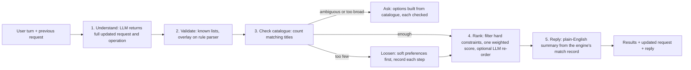

# Design: Conversational Recommendation Engine (v2)

Status: partial implementation; planned sections are labelled below.

Implements [the PRD](prd-conversational-engine.md). Updated October 16, 2026.
Phases 1–2 are implemented, with initial results-first policy work from phase 3.
Quality and latency acceptance remain open. The harness measures changes; there
is no runtime feature flag gating the structured-request path.

## Target pipeline (includes unimplemented phases)



## 1. Structured request (implemented)

The runtime type is defined in
[`requestSpec.ts`](../backend/src/engine/requestSpec.ts). Fields are flat; the
hard/soft distinction is conceptual, not nested JSON.

```ts
interface RequestSpec {
  countries: string[]           // production countries, ISO 3166-1 alpha-2
  languages: string[]           // original languages
  years?: { min?: number; max?: number }
  releasedWithinDays?: number
  dateRange?: { from?: string; to?: string }
  format: 'movie' | 'tv' | 'both'
  excludeGenres: string[]
  maxCertification?: string     // parsed, not fully enforced
  genres: string[]
  tones: string[]
  themes: string[]
  references: string[]
  referenceSuggestions: string[] // catalogue-validated search seeds
  actors: string[]
  creators: {
    name: string
    role: 'director' | 'writer' | 'producer' | 'creator'
    allowOtherRoles: boolean
  }[]
  popularity?: 'mainstream' | 'niche'
}

interface SpecTurn {
  operation: 'new' | 'refine' | 'add' | 'remove' | 'replace' | 'pivot'
  spec: RequestSpec
}
```

- **Understanding:** `parseRequestSpec` receives the previous spec, latest message and up to six earlier user messages. It uses JSON-object mode plus a schema-shaped prompt, not provider-enforced JSON Schema.
- **Validation:** `validateSpecTurn`/`validateSpec` normalise codes, vocabulary,
  lists, people and date/year bounds. `assessSpecTurn` now gates raw provider
  output before accepting this sanitisation: operation/object/list/format shape,
  usable direction, explicit representation of populated saved fields and
  protection against implicit hard-constraint loss on refine/add. Rejected
  updates are logged with a reason; per-field discarded-value logging is still
  unfinished. Sanitisation alone remains permissive for client-supplied specs.
- **Fallback:** first requests (or legacy follow-ups without a saved spec) can
  still use rules. With a saved spec, failed/unusable follow-up understanding
  returns the unchanged spec and a text clarification, without retrieval or
  legacy LLM parsing. It explicitly says the change was not applied. This is a
  conservative clarification policy, not equivalent offline understanding.
- **Mapping:** `PreferenceParser.applySpec` overlays successful understanding on rule-derived preferences; there is no separate `specToPreferences` or `applyDelta`.

### As built (phase 2)

- **Full request, not a change set:** the implementation chose a complete updated `RequestSpec` rather than the originally proposed delta. `diffSpecs`/`summariseOrigins` derive changes (e.g. "Added Indonesian alongside Malaysian."). The eval has not independently compared full-spec versus delta reliability.
- **Validation (`requestSpec.ts`):** country/language code checks (including the catalogue's `cn` language code), canonical genre and tone names with aliases, reversed-year swapping, out-of-range year rejection, and list caps. Actor names matching creator names are removed; creator entries are capped but not fully deduplicated.
- **Applying it:** rather than a separate `specToPreferences`, `PreferenceParser.parse` overlays the spec (`applySpec`) on the rule output, so the spec is authoritative and the rules still fill fields the spec lacks. Rule guards still apply:
  - "Indie" becomes discovery intent, not a hard genre.
  - Popularity is accepted only when the wording supports it.
- **Operation mapping:** new/pivot → hard pivot; replace → continue + replace; add/remove → widen; refine → narrow.
- **Failure handling:** the recommendations route shares a four-second elapsed
  LLM window across all stages, without SDK retries; see the latency slice
  below. Standalone client calls retain 8 s understanding/15 s other-stage
  limits, also without retries. The first 429 starts a process-local 60 s
  cooldown. Cached output can still be used. This is not a whole-HTTP-turn
  deadline and does not circuit-break timeouts/503s.
- **Refinement retention (October 16):** the prompt explicitly distinguishes a short genre/tone answer from a pivot, retains prior genres unless explicitly replaced/rejected, and preserves unrelated country/format fields. Relative release windows should not invent extra year bounds.
- **Candidate reuse (October 16):** compare current/previous validated specs with `diffSpecs`. Any changed field other than tones requires fresh catalogue retrieval; missing previous structured state also requires retrieval. Unchanged scope and tone-only refinements may re-rank previous candidates. This prevents a new decade/window from being applied only to ten old results.

### Existing engine invariants to preserve

- Production country and original language are distinct. The successful spec
  path treats nationality as country unless language is explicit. Rule-origin
  parsing has its own demonym/language taxonomy; do not assume both paths agree.
- Country filters require country evidence, which can be inferred from a
  country-constrained discovery query when TMDB omits the field; it is not
  always independent title-detail evidence. Language filters tolerate missing metadata.
  Origin lists use `|` and discovery fans out per origin. Established candidates
  are reserved so low-vote new releases do not crowd out small catalogues.
- Indie is a soft discovery signal, not a TMDB genre. TV genre mappings and
  keyword evidence differ from films; qualified dramas need their qualifier.
  Genre relaxation is recorded per request with `AsyncLocalStorage`.
- Engine-level "last retrieval diagnostics" are shared mutable state; do not
  rely on them for concurrency-safe per-request evidence.
- Vote-confidence ranking separates unknown from zero votes, uses Bayesian
  ratings and pool-relative popularity, and scales recency with vote support.
  Exact weights belong to source/tests, not duplicated prose constants.
- Requested genres are exempted from diversity penalties. Warm-tone conflict
  demotion is conditional, not a blanket genre ban.
- Creator-role evidence is distinct from acting credits; unqualified "films
  by" permits directing-first fallback, while explicit roles must stay exact.
- Reference anchors are suppressed unless rewatching is intended. Contrastive
  concept/tone evidence must not be reduced to broad genre overlap.
- Preserve country-aware change/relaxation notes and stock-phrase filtering.
  Detailed historical diagnoses, tuning values, catalogue examples and UI
  rationale remain in the [snapshot recovery map](archive/2026-10-16/README.md).

### Enforcement and turn-boundary gaps (source cross-check, October 16)

- Internal TMDB candidates now retain exact release/first-air dates. The common
  `filterHardConstraints` checks format, date, year, country, known language and
  exclusions before ranking and after final metadata hydration, including reused,
  talent and specialised candidates. Missing dates are hydrated from cached TMDB
  details when possible for date-bound requests, otherwise excluded with
  request-local counts and user-facing uncertainty copy. Scope changes still
  merge prior candidates, but they must pass these gates. Missing language
  metadata remains permissive; country evidence may be discovery-derived.
  Detailed certification enforcement is separately described in
  [system patterns](systemPatterns.md#validation-and-safety-pattern).
- First-request/legacy fallback can still parse rules in the route and legacy
  LLM preferences in the engine, so their metadata can differ. Saved-spec
  follow-ups no longer enter that divergent path when understanding fails.
- Unsupported critic-source detection checks the original `description`, not
  the latest follow-up. Since chat resends that description, accepting the
  offered proxy can repeat the question; naming an unsupported source only in
  a follow-up can miss the guard. Consent/denial is not explicitly tracked.
- `appliedConstraints` unions supplied cumulative tags with current parser tags;
  it is not a canonical active spec or an enforcement trace. Frontend pivot
  handling clears some history, but replace/remove can leave obsolete tags.
- Freeform understanding receives user messages and the previous spec, not the
  assistant question/options. Structured catalogue choices now bypass it using
  signed scoped changes; legacy choices still rely on wording. Initial copy is
  now deterministic; the standalone intro client has no prior-reply context.
  General cross-turn repetition prevention remains open.

## 2. Conversation state (implemented, conservative failure handling)

### Progressive delivery refinement (October 16, locally implemented)

- Keep JSON responses for existing API/eval callers; browser POST requests opt
  into `text/event-stream`. Emit actual understanding, retrieval, ranking,
  verification and catalogue-choice stage transitions, then one terminal
  response/error event. No invented titles, claims of completed understanding or
  saved-state updates in progress events.
- Five seconds becomes a soft useful-response target. The user approved a
  provisional 15-second overall deadline; the four-second shared LLM window
  remains unchanged. This does not claim Gemini will complete within that window.
- Return final constraint-checked titles with deterministic copy. Remove optional
  explanation/intro/clarification wording and trailers from the critical path;
  trailers load on details open. Required metadata hydration/gates still run.
  Do not repeat legacy LLM preference parsing after route understanding.
- Retain cancellation/disconnects, request IDs, signed option retries and
  original-spec timeout semantics. Stage timings accompany terminal diagnostics.
  Browser parsing must handle fragmented UTF-8/events and fail explicitly on an
  interrupted stream without a terminal event; progress alone never changes state.
- Local tests plus a mocked browser interaction verify progress, terminal results,
  cancel/retry/reset state retention and lazy trailers. No new live recommendation/
  Gemini calls were made. Live quality, proxy buffering and deadline calibration
  remain acceptance work, not a reason to alter ranking.

### Whole-turn deadline slice (October 16, locally implemented)

- The original slice enforced a five-second server-work deadline. The delivery
  refinement above supersedes that constant with the approved provisional
  15-second ceiling; the cancellation/state rules below remain in effect.
  Share cancellation across catalogue fetches (including response bodies) and
  LLM transport, and cancel work when the HTTP response connection closes.
  Other endpoints keep their current provider timeouts.
- On expiry send one explicit incomplete-search clarification, no partial
  recommendations and the original saved spec. An understood change is not
  committed if the complete response cannot finish; ask the user to retry.
  Never report a deadline as catalogue absence or start widening on abort.
- Rethrow cancellation through provider fallback catches and gate cache writes,
  stage boundaries and final replies. Do not cache aborts as empty/null results.
  Dispose timers/listeners on success, error, expiry and disconnect.
- Timeout replies carry `requestDiagnostics: { outcome: 'timed_out',
  deadlineMs: 15000, elapsedMs, stages }`. Completed replies also retain timings.
  Frontend messages/passes and evaluation transcripts retain diagnostics.
  The browser now aborts fetch on Cancel, new-chat reset or component unmount;
  request IDs still protect against late UI updates. The timeout clarification
  does not claim any discarded understanding contributed (`llmDiagnostics.used`
  is false), though provider failure evidence remains available.
- The deadline is an event-loop/server-work boundary, not a guarantee about
  network transit or CPU stalls, nor live quality acceptance. Conservative
  timeouts may return fewer completed recommendation turns; measure that before
  deployment rather than claiming cancellation improves catalogue coverage.
- The first subsequent user-authorised live check failed to complete: request
  understanding consumed its four-second window, leaving about one second for
  fallback retrieval/ranking/enrichment. This demonstrates a stage-allocation
  risk, not an established quota failure or lack of matches. Before tuning,
  distinguish a fast initial conversational response from a completed title list;
  the exact evidence belongs to the [verification ledger](progress.md).

### Latency reliability slice (October 16, locally implemented)

- Give uncached LLM work one shared four-second elapsed window from entry to the
  recommendations route, rather than a fresh timeout/retry allowance per stage.
  Cached answers remain usable. Every dispatched completion has a cancellable
  remaining-time deadline and no automatic SDK retries; the first 429 starts
  the existing process-local cooldown immediately.
- Record request-local stage/reason/status/duration evidence without provider
  error bodies, prompts or credentials. Preserve existing fallback shapes and
  saved-spec clarification on failed understanding; optional copy must not
  extend the expired LLM window. Other endpoints/standalone client calls keep
  their stage timeouts, but no longer retry automatically. API `llmDiagnostics`
  exposes optional `failures` and `budgetExhausted`; the frontend retains them
  and evaluation transcripts persist them, without changing `used`/`stages`
  semantics or claiming every attempted call contributed.
- Give catalogue-choice construction a 1.5-second elapsed scheduling window. Check
  the window before every additional preview, accept only completed evidence,
  and log/describe incomplete checks rather than invent options. Completed
  widening options remain valid, with explicit incomplete-check wording;
  insufficient completed directions fall through to results. Do not race
  uncancelled provider work or cache a partial/unknown outcome as verified.
- This LLM-specific slice alone does not bound the full HTTP turn. It now runs
  inside the separate whole-turn deadline above, which also cancels in-flight
  catalogue work. Streaming and live quality/latency acceptance remain outstanding.

### Reliability implementation slice (October 16, locally implemented)

- Gate raw understanding before accepting its sanitised spec: require a
  recognised operation and at least one usable request signal. Non-pivot
  updates must explicitly represent populated previous fields rather than
  silently omit them. Refine/add cannot remove saved hard constraints.
- If understanding is unavailable/unusable on a follow-up with a saved spec,
  return that spec with a plain-language text clarification and do not run
  retrieval or legacy LLM parsing for an unconfirmed change. This conservative
  path does not pretend to apply the follow-up. First requests retain rules.
- Preserve exact release/first-air dates in internal candidates. For date-bound
  searches, resolve missing dates through cached TMDB details when possible,
  then gate format/date before ranking and again after final metadata hydration.
  Unknown dates are excluded with request-local diagnostic counts; widening
  copy must distinguish missing evidence from catalogue absence.
- Validated with mocked clients only. No live Gemini probes/evaluation in this
  slice; catalogue-built option work follows separately.

- The client sends `spec` (the previous `RequestSpec`) with each turn. The server returns the updated `spec`.
- `userTurns` is still sent so the rule fallback can work.
- No server-side session store is needed (the API stays stateless).
- The engine skips older `parsePreferences` when a new spec is available.
  Failed saved-spec follow-ups return clarification before the engine runs.
  Other fallback paths can still attempt legacy parsing within the remaining
  LLM window, but no application LLM completion retries automatically.

## 3. Catalogue check, clarification and loosening (partially implemented)

### Catalogue-choice slice (October 16, locally implemented)

- Reuse the real retrieval/ranking/final metadata gates in a catalogue-preview
  mode that never calls an LLM or loads trailers. Build genre choices from the
  matching titles, not an invented tone promise; verify each with the same
  scoped request and require at least three distinct final matching titles.
  The broad pool is capped at 30, checks use the actual result limit (normally
  ten); requests for fewer than three results skip these choice promises. At
  most five genre paths are checked and at most three choices are offered.
  Identical matching title sets are not separate useful directions; fewer than
  two supported directions falls through to results. Structured undirected
  browsing no longer invents default Drama/Comedy preferences or searches country
  words as title terms. Actual genre directions still use normal retrieval.
- Keep the existing active spec for every choice; a genre choice adds only a
  catalogue-backed genre. Structured empty-result widening changes one named
  dimension and is checked by that same preview before being offered. Genre
  widening is considered before language/country/format/release-window widening.
  Nothing is changed automatically; selection adds explicit prose about what
  widened. General automatic soft-relaxation records remain unimplemented.
- Attach expiring signed, stateless choice tokens to questions. Tokens bind the
  current spec, original description, region, explicit controls, user-turn
  history, resulting spec, operation and exact label. Frontend and eval
  replay them on selection, avoiding a second LLM interpretation. Stale/invalid
  selections preserve state and ask, never silently widen. Process restart
  invalidates tokens; they expire after one hour and require the same process,
  so multi-worker/restart-safe signing is not claimed. The frontend keeps the
  exact selected token for transport retries, without duplicating user turns.
  Freeform turns retain ordinary understanding. Normal initial copy is now
  deterministic; neither previews nor click interpretation uses an LLM.
- Cache at most 50 preview outcomes for 60 seconds within the process; the key
  includes the full engine request and result limit. This is catalogue
  evidence, not a permanent availability guarantee. Unknown/failed checks do not
  count as viable. If no useful supported choice exists, try results or ask for
  freeform guidance rather than fabricate options. Thrown catalogue errors use
  the standard logged API error response. Previews use an isolated engine
  instance and request-local diagnostics, not production "last request" fields.
  No live providers in tests. Sequential preview work is bounded by count and
  elapsed admission; the separate turn deadline now cancels in-flight previews
  at expiry. Live successful-response quality/latency remains unverified.

- **Initial policy implemented locally October 16:** a validated spec with a
  concrete genre, tone, theme, reference, person or date direction bypasses
  first-turn clarification and attempts results. Origin/format alone do not
  trigger this spec-based override; separate legacy intent/confidence overrides
  still exist. Structured empty retrieval now uses checked, opt-in widening.
  This is not a deployment claim.
- **Legacy option check (no accepted spec):** deterministic or LLM-written
  option strings are parsed by rules and checked with `estimateAvailableTitles`;
  the minimum is 3. Unknown counts and the 2.5 s timeout now fail closed, and the
  timer is cleared. This does not use the active spec or fully model specialised
  ranking paths; it is not a guarantee of three final results. The historical
  Malaysian festival-drama option returned two on that path.
- **Current transparency:** genre-filter relaxation, origin-change notes and
  selected catalogue-widening prose exist. A general recorded loosening plan does not.

### Deferred catalogue strategy and remaining scope
- The earlier cheap `probeCatalog(spec)`/`total_results` sketch was not used for
  choice viability: discovery totals can overstate final specialised/quality
  matches. The implemented preview above uses final results instead.
- A calibrated "too many strong matches" threshold and tone/theme clustering
  remain future work. The earlier ~500-title/eight-result sketch is not the
  implemented threshold; the current minimum is three for small catalogues.
- **Loosening order:**
  1. Themes.
  2. Tones beyond the first.
  3. Genres not mentioned in the latest turn.
  4. Release window.
  5. Never loosen countries or languages without saying so; prefer widening to neighbouring options only if the user agrees.

  Each step is recorded as `relaxations: { field, from, to, reason }[]`.
  Protect constraints stated in the latest turn (R4). A release window or other
  hard constraint must not be silently relaxed; ask before widening it. The
  general relaxation record and consent flow are not implemented.

## 4. Ranking (planned simplification)

The current engine still combines `RankingScorer` with post-scoring boosts,
penalties and final-selection logic. The following is the target, not a claim
that those adjustments have been retired.

- Date/format/year/origin/exclusion gates now apply across candidate sources.
  Language filtering tolerates missing metadata. Detailed certification
  enforcement is not implemented; do not treat every parsed hard field as a
  fully enforced guarantee.
- `RankingScorer` stays the single scorer. Tone and theme fit become scorer inputs instead of separate engine boosts.
- **Optional LLM re-order:** score the top 30 titles from synopsis against tone and themes on a 0–1 scale, blended into the score at about 30% weight. Results are cached per (spec, title).
- The post-scoring adjustments in `recommendationEngine.ts` (~2180–2260) are retired one at a time, each change checked against the evaluation set.

## 5. Reply (planned facts record; progressive transport implemented)

Current responses use deterministic initial explanations/constraint copy and an
interpretation note. Some paths omit `assistantMessage`; the frontend supplies
its own fallback. Real stage progress streams before the final validated list;
optional generated prose is not delivered later. `buildReplyFacts` and
fact-grounded prose streaming are not implemented.

`buildReplyFacts(spec, relaxations, results)` produces the facts the reply is written from:

- `understood`: a short phrase describing the request.
- `relaxed`: what was loosened, if anything.
- `coverage`: e.g. "4 Malaysian + 6 Indonesian".
- `suggestions`: follow-ups the catalogue can support.

`generateResultsIntro` writes the reply from these facts only. The prompt bans stock phrases and gets the previous reply so it doesn't repeat itself.

## Evaluation harness (`backend/eval/`)

- `cases.json`: 52 cases, each with `id`, `category`, `turns` (text or `{ choose: "<option substring>", text: "<fallback>" }`), and `expect`:
  - `countries`, `coverAllCountries`, `avoidCountries`, `languages`, `coverAllLanguages`, `yearMin` / `yearMax`;
  - `format`, `excludeGenres`, `toneConflict`, `anyGenre`, `allGenres`, `allGenresShare`;
  - `excludeTitles`, `cast`, `director`;
  - `minResults`, `clarify` (whether a clarifying question should be asked).
- `run.ts`: replays the turns against `POST /recommendations` exactly like the frontend (base query plus `clarificationContext.userTurns`). Picks options by substring and answers a question with its first option if one is asked unexpectedly. It then scores each check, writes `eval/reports/<timestamp>.json` and prints a summary.
- **Metrics:** hard-constraint check pass rate, final empty-list rate, follow-up case pass rate, tone-check pass rate, first-turn clarification appropriateness, p50 / p90 turn latency. These are proxy checks, not a semantic relevance judge. Release windows are not checked at exact-date granularity.
- **Scoring tolerances:** country/language/year/format checks accept a 90%
  matching share, actor/director checks 60%, and genre checks normally 60%.
  `avoidCountries` allows up to 50% from the avoided origins; tone checks use
  genre conflicts in the top five, not narrative tone. There is no certification
  check. Exact scoring belongs to [the runner](../backend/eval/run.ts); a passed
  case does not certify every recommendation or every hard requirement.
- **Replay caveat:** if the requested option substring is absent, the runner takes the first option. It also answers unexpected questions with the first option (up to two extra turns). That can explicitly widen an origin or change direction. Review transcripts before attributing a failed final check to state loss.
- **Reports:** baseline reports are eligible for version control; other reports
  are ignored local files. New transcripts retain optional API LLM failure/deadline
  diagnostics. See [progress](progress.md) for dated results and provider caveats.
  No full live run covers the final October 16 candidate-reuse fix or later slices.
- Terminal request diagnostics include stage durations. Reports now distinguish
  timed-out turn counts and completed-result latency; a case fails if any turn
  timed out or its final outcome was not results, even if prior titles remain.
  This still does not make genre proxies a semantic quality judge.
- The API now returns `originCountries` on each recommendation so country constraints can be checked.

## Risks

- **LLM cost and latency:** route understanding and optional talent recovery can
  invoke a provider within the shared window; standalone/legacy callers can
  still use other client methods. SDK retries are disabled. The deadline returns a
  conservative incomplete-search reply at expiry; it does not prove useful
  recommendations can complete within that target. Timeout rate and successful
  turn quality still need live measurement. Use the [verification ledger](progress.md) for evidence.
- **Inconsistent LLM output:** JSON-object mode is not provider-enforced schema.
  The new acceptance gate blocks unusable/omitted-state updates and asks rather
  than guessing on failed saved-spec follow-ups. It cannot prove the model's
  interpreted replacement/pivot matches the user's semantics; live quality
  evaluation and per-field rejection logging remain open.
- **TMDB rate limits** from catalogue checks: bounded previews and cached outcomes
  reduce repeated work, but real final-pipeline checks can make several provider
  calls each. The scheduling window does not itself cancel a preview, but the
  shared whole-turn deadline/disconnect signal does.
